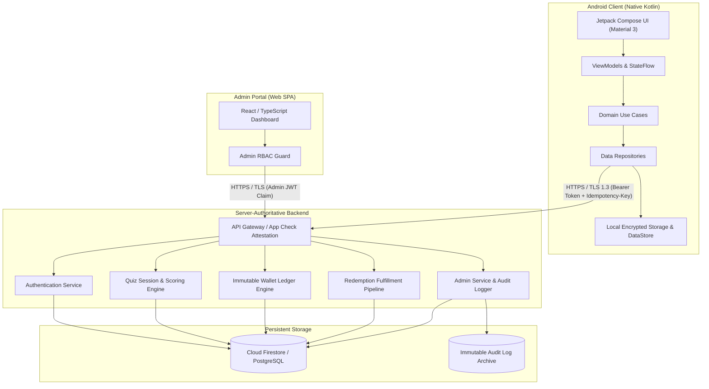
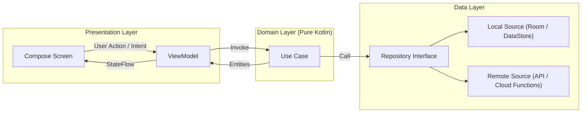
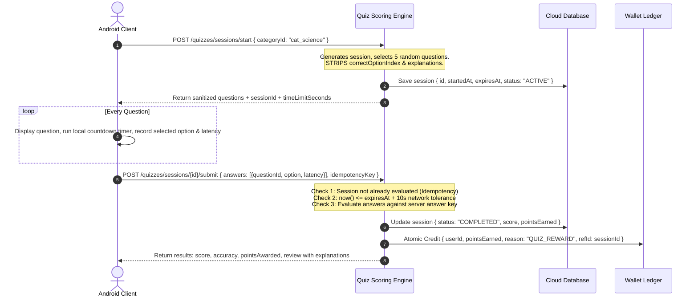
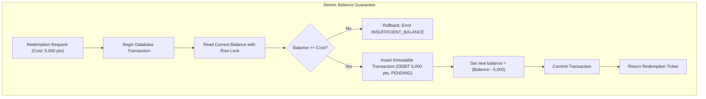
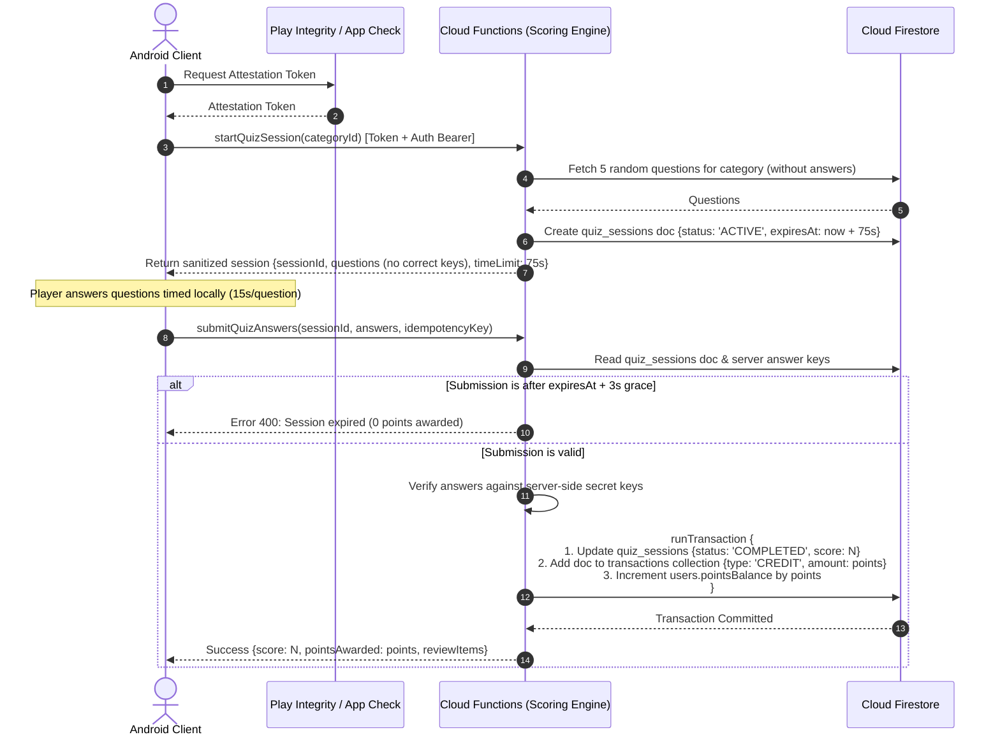
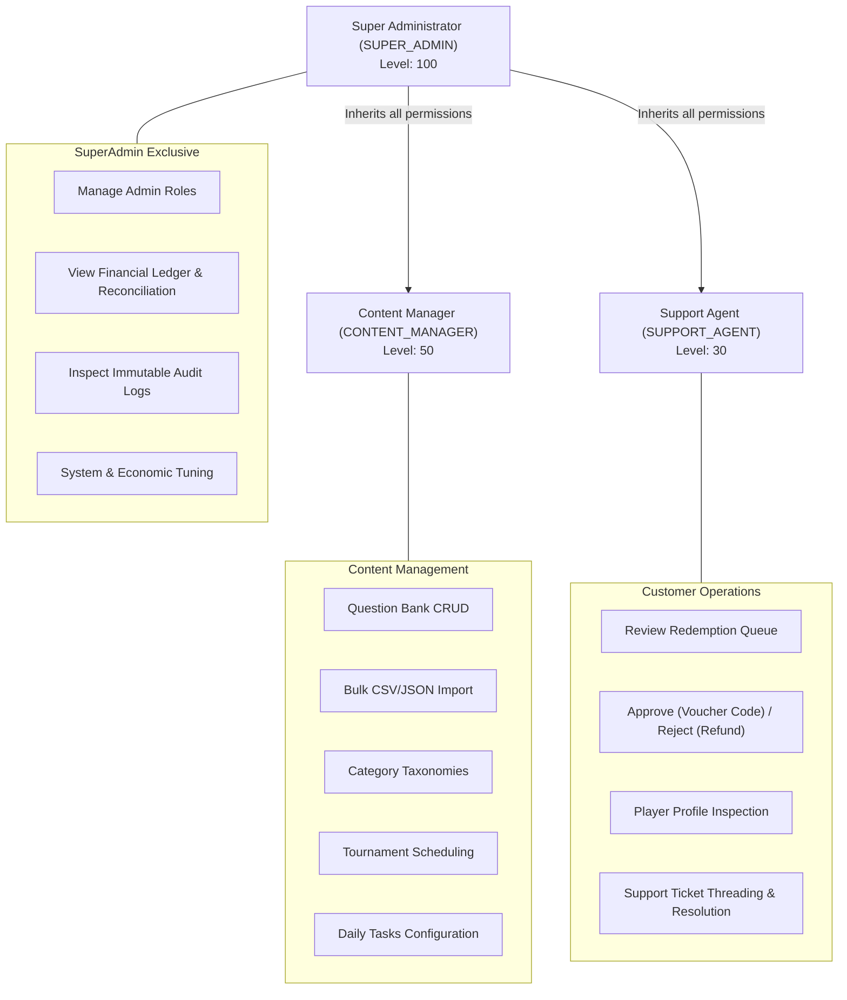
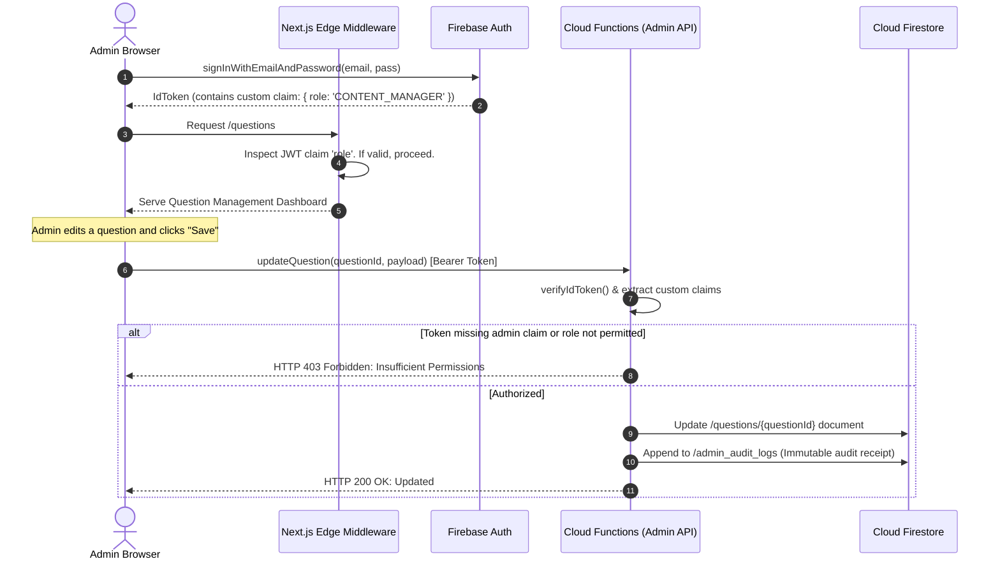
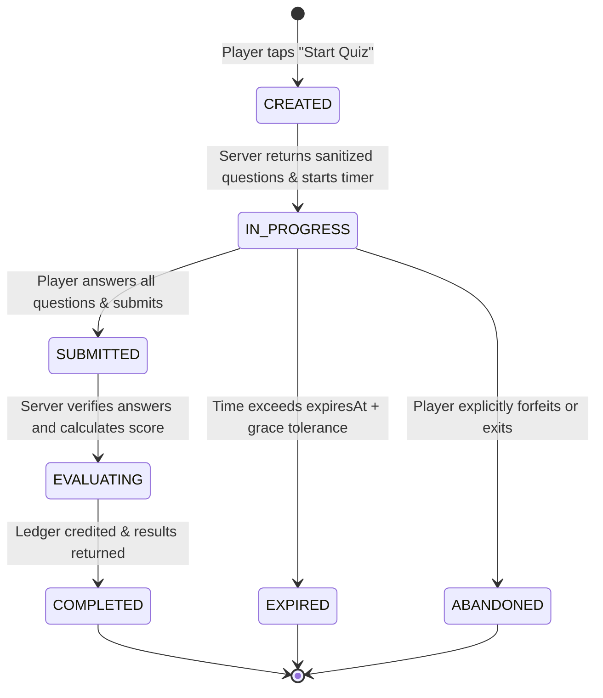
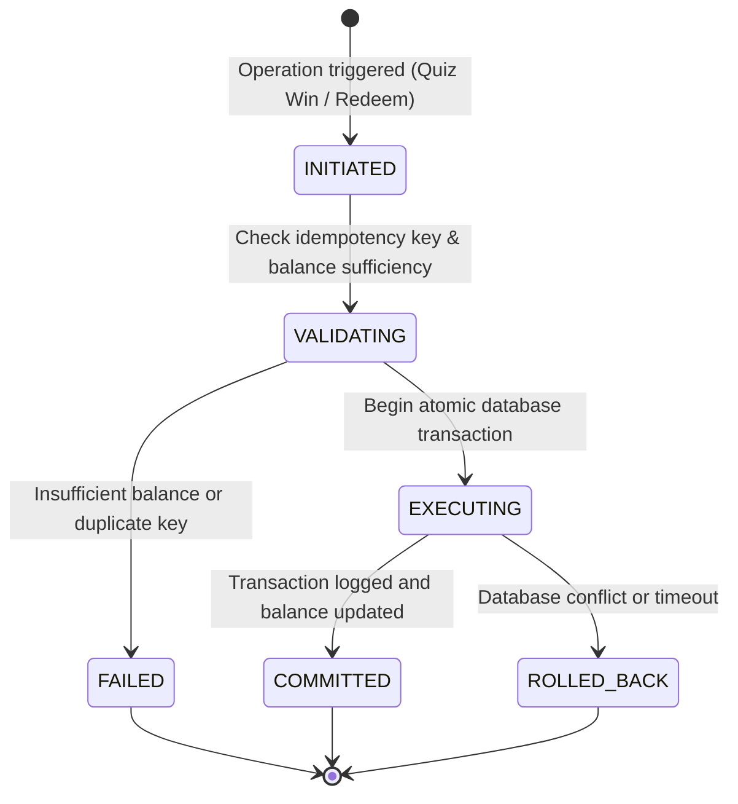
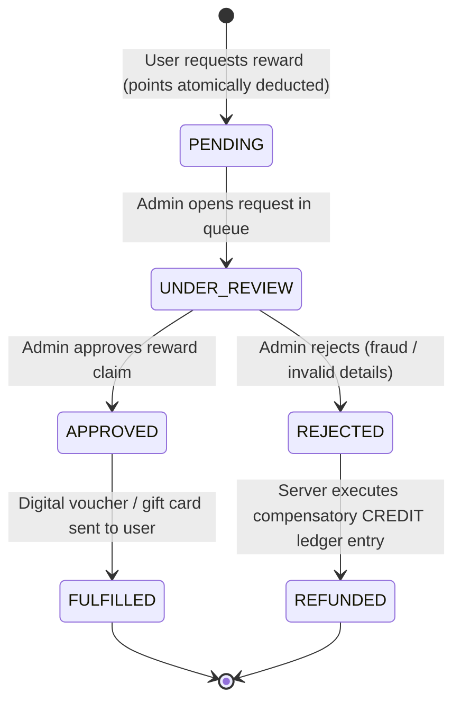

# QuizEarn — Technical Architecture & System Blueprint

> Single comprehensive architectural specification for the QuizEarn Android application, backend services, and web administration panel.

---

## 1. System Overview & Topology

QuizEarn is an original Android quiz-and-rewards ecosystem designed for fair competition, secure gamified learning, and transparent reward redemption.



---

## 2. Android Client Application Scope & Target Specification

### Target Specifications
- **Application ID:** `com.quizearn.app`
- **Platform:** Native Android
- **Language:** Kotlin 2.0+
- **Min SDK:** 24 (Android 7.0 Nougat — ~95%+ device reach)
- **Target SDK / Compile SDK:** 35 (Android 15 — Google Play 2026/2027 compliance)
- **UI Toolkit:** Jetpack Compose with Material Design 3

### Core Feature Scope

| Feature Module | Description | Key Deliverables |
| :--- | :--- | :--- |
| **Splash & Onboarding** | Welcome experience & value proposition | Animated splash, 3-slide onboarding, DataStore launch flag. |
| **Authentication** | User identity & session lifecycle | Sign In, Sign Up, Password Reset, form validation, token persistence. |
| **Home Dashboard** | Main navigation hub | Daily reward streak, balance badge, featured quizzes, category carousel. |
| **Quiz Gameplay** | Interactive timed trivia | Category browser, timed question cards, 4 options, answer lock, forfeit confirmation. |
| **Results & Review** | Post-quiz performance & breakdown | Score presentation, accuracy %, points awarded animation, answer review mode. |
| **Tasks & Tournaments** | Ongoing gamification & events | Daily challenges, progress bars, scheduled tournaments, prize pools. |
| **Wallet & Rewards** | Economic management & redemption | Real-time balance, categorized transaction ledger, reward catalog, claim modal. |
| **Profile & Settings** | Account maintenance & customization | User stats, leaderboard rank, dark/light theme, notification preferences, account deletion. |
| **Leaderboard** | Community standings | Global/Weekly rankings, username-only display (strict PII protection). |

---

## 3. Clean Architecture & MVVM Pattern

The Android application strictly adheres to Clean Architecture separated into Presentation, Domain, and Data layers with Unidirectional Data Flow (UDF).



### Layer Responsibilities

#### Presentation Layer (`com.quizearn.app.ui`)
- **Compose UI**: Declarative screens displaying immutable `UiState`.
- **ViewModels**: Retain UI state across configuration changes, process user intents, and expose `StateFlow<UiState>`.
- **Side Effects**: Single-event actions (navigation, snackbars) handled via `Channel<UiEvent>` and observed with `LaunchedEffect`.

```kotlin
// Pattern: Unidirectional Data Flow
data class QuizPlayUiState(
    val isLoading: Boolean = false,
    val currentQuestionIndex: Int = 0,
    val totalQuestions: Int = 0,
    val currentQuestion: QuestionUiModel? = null,
    val selectedOptionIndex: Int? = null,
    val remainingSeconds: Int = 15,
    val isAnswerLocked: Boolean = false,
    val errorMessage: String? = null
)

sealed interface QuizPlayUiEvent {
    data class NavigateToResults(val sessionId: String) : QuizPlayUiEvent
    data class ShowToast(val message: String) : QuizPlayUiEvent
}
```

#### Domain Layer (`com.quizearn.app.domain`)
- **Pure Kotlin**: Completely free of Android framework dependencies.
- **Models**: Business entities (`QuizSession`, `WalletBalance`, `Transaction`, `Reward`).
- **Use Cases**: Single-responsibility business actions:
  - `StartQuizSessionUseCase`
  - `SubmitQuizAnswersUseCase`
  - `GetWalletLedgerUseCase`
  - `SubmitRedemptionUseCase`

#### Data Layer (`com.quizearn.app.data`)
- **Repositories**: Single source of truth coordinating local cache and remote network calls.
- **Local Source**: Jetpack DataStore for user preferences; EncryptedSharedPreferences for tokens; optional Room cache.
- **Remote Source**: DTO models, network interceptors (Authorization Bearer injection, `Idempotency-Key` generator).

#### Dependency Injection (DI)
- **Primary Recommendation:** **Hilt** (`dagger.hilt.android`).
  - Native integration with Android Jetpack navigation and Compose (`@HiltViewModel`, `hiltViewModel()`).
  - Scoped lifecycles: `@Singleton`, `@ViewModelScoped`.
  - In environments with restricted annotation processing, **Koin** serves as the zero-code-gen fallback.

---

## 4. Server-Authoritative Scoring Model & Anti-Cheat

### Anti-Cheat Core Principle
> **The client is an untrusted presentation layer.** Correct answers, scoring calculations, and wallet credit operations must never originate from or be decided by the client device.



### Security Boundary Guarantees
1. **Zero Pre-Exposure:** The server API response for `/sessions/start` strictly omits `correctOptionIndex` and `explanation`.
2. **Server-Side Expiry:** `expiresAt` is timestamped by the server. Submissions arriving after `expiresAt + graceTolerance` are rejected or awarded zero points.
3. **Replay & Concurrency Protection:** Each submission requires the session ID and an `Idempotency-Key`. Subsequent requests return the stored evaluation without re-crediting points.

---

## 5. Wallet Ledger Integrity & Concurrency Architecture

### Mathematical Invariant
$$\text{User Points Balance} = \sum \text{Credits} - \sum \text{Debits}$$

User point balances are maintained via an **immutable append-only transaction ledger**. Direct manual balance edits are strictly prohibited.



### Wallet Invariants
1. **Append-Only:** The `transactions` collection is append-only. Updates and deletions are rejected by database rules.
2. **Atomic Ledger Insertion:** Any change to `users.pointsBalance` must occur within the same database transaction as the corresponding `transactions` insert.
3. **No Negative Balances:** Every debit verifies that `balance - debitAmount >= 0`. If false, the transaction rolls back immediately.
4. **Automatic Compensatory Refunds:** If a redemption request is rejected by an admin, an atomic compensatory credit transaction is created with reason `REDEMPTION_REFUND`.

---

## 6. Recommended Backend Architecture: Evaluation & Decision

### Backend Evaluation

| Evaluation Criteria | Option A: Firebase-First (CONFIRMED) | Option B: Custom Node.js / PostgreSQL |
| :--- | :--- | :--- |
| **Authentication** | Firebase Auth (Email/Pass, Google, Anonymous) with built-in JWT verification and token refresh. | Custom JWT implementation, bcrypt password hashing, refresh token rotation required. |
| **Database** | Cloud Firestore (Managed NoSQL, real-time sync, offline persistence, automatic sharding). | PostgreSQL (ACID relational, requires VPS/RDS hosting, connection pooling, migrations). |
| **Business Logic** | Cloud Functions (Node.js/TypeScript v20+) for server-authoritative scoring & ledger mutations. | Express.js / Fastify / Go microservices hosted on Cloud Run or VPS. |
| **App Attestation** | Firebase App Check with Android Play Integrity API integration out of the box. | Custom Play Integrity token verification endpoint and Google Play API credentials needed. |
| **Admin Authorization** | Firebase Auth Custom Claims (`role === 'admin'`) enforced in rules and functions. | Custom middleware checking PostgreSQL user role records. |
| **Hosting & Ops** | Fully serverless, zero infrastructure management, automatic multi-region failover. | Requires Linux VPS maintenance, Docker orchestration, TLS cert renewals, DB backups. |
| **Real-time Sync** | Native Firestore snapshot listeners for live leaderboard and wallet updates without polling. | Requires custom WebSocket / SSE server infrastructure and reconnection handling. |

### Technical Decision: Confirmed Firebase-First Architecture
For QuizEarn, **Firebase-First Serverless Architecture** (with Cloud Functions for all scoring and ledger operations) is formally selected and confirmed:

1. **Hardware-Attested Anti-Cheat (Firebase App Check + Play Integrity):**
   In a rewards app where real gift cards are distributed, preventing automated bot clicks and modified APKs is the number one priority. Firebase App Check transparently gates Cloud Functions behind genuine Google Play hardware attestation.
2. **Zero-Client-Trust Firestore Security Rules:**
   Firestore Security Rules permanently enforce `allow write: if false;` on `transactions`, `redemptions`, and `users.pointsBalance`. Clients have zero ability to mutate points directly; all economic adjustments must pass through signed Cloud Functions.
3. **Real-Time Dynamic Sync:**
   Native snapshot listeners allow player wallets, active tournament rankings, and leaderboards to update dynamically on user devices without battery-draining continuous polling.
4. **Serverless Scaling & Zero Operations:**
   Eliminates server provisioning and database maintenance, allowing high-availability scaling during live tournament traffic spikes.

---

## 6.1 Server-Authoritative Scoring Sequence



---

## 6.2 Immutable Wallet Ledger & Double-Entry Invariants

The QuizEarn economic engine enforces strict mathematical integrity:

$$\text{CurrentBalance} = \sum_{\text{tx} \in \text{Credits}} \text{amount}(\text{tx}) - \sum_{\text{tx} \in \text{Debits}} \text{amount}(\text{tx})$$

### Core Economic Rules:
1. **No In-Place Balance Mutations:**
   Points balance cannot be directly incremented or decremented without an accompanying entry in the `transactions` ledger.
2. **Idempotency Guard:**
   Every redemption and quiz submission must carry a client-generated UUID `idempotencyKey`. Duplicate keys within 24 hours are rejected without state mutation.
3. **Atomic Firestore Transactions:**
   Every balance change executes inside `db.runTransaction()`. The transaction reads the user document, verifies sufficient balance, writes the transaction receipt, and updates the balance atomically.
4. **Compensatory Refund on Rejection:**
   When a redemption request is rejected by an administrator, the server automatically appends a compensatory `CREDIT` transaction (`TransactionReason.REDEMPTION_REFUND`) restoring the points.

---

## 6.3 Firestore Security Rules Blueprint

```javascript
rules_version = '2';
service cloud.firestore {
  match /databases/{database}/documents {
    
    // User Profiles: Users can read their own profile; strictly no client writes to pointsBalance or role
    match /users/{userId} {
      allow read: if request.auth != null && request.auth.uid == userId;
      allow create: if request.auth != null && request.auth.uid == userId
                    && request.resource.data.pointsBalance == 0
                    && request.resource.data.role == 'USER';
      allow update: if request.auth != null && request.auth.uid == userId
                    && !request.resource.data.diff(resource.data).affectedKeys().hasAny(['pointsBalance', 'role', 'status']);
      allow delete: if false; // Deletion handled via Cloud Function
    }

    // Public Categories & Questions: Read-only for authenticated users
    match /categories/{categoryId} {
      allow read: if true;
      allow write: if false;
    }
    match /questions/{questionId} {
      allow read: if false; // Never exposed to client directly; fetched via Cloud Functions
      allow write: if false;
    }

    // Quiz Sessions: Read-only for the owning player; creation & scoring via Cloud Function only
    match /quiz_sessions/{sessionId} {
      allow read: if request.auth != null && resource.data.userId == request.auth.uid;
      allow write: if false;
    }

    // Transactions Ledger: Strictly READ-ONLY for user; mutations only via Cloud Functions
    match /transactions/{txId} {
      allow read: if request.auth != null && resource.data.userId == request.auth.uid;
      allow write: if false;
    }

    // Redemptions: Users can read their own claims; creation & status updates via Cloud Function only
    match /redemptions/{redemptionId} {
      allow read: if request.auth != null && resource.data.userId == request.auth.uid;
      allow write: if false;
    }

    // Leaderboards: Public read (sanitized usernames only, zero PII)
    match /leaderboards/{timeframe}/rankings/{entry} {
      allow read: if true;
      allow write: if false;
    }
  }
}
```

---

## 7. Web Admin Panel Architecture & Role-Based Access Control (RBAC)

The QuizEarn Admin Panel is a standalone, enterprise-grade Web application decoupled from the mobile client repository or deployed alongside Firebase services.

### 7.1 Web Tech Stack Selection & Architectural Rationale

| Layer | Chosen Technology | Selection Rationale |
| :--- | :--- | :--- |
| **Framework** | **Next.js 14+ (App Router) / React 18** | Fast server components, edge middleware for zero-flash route protection, robust TypeScript support. |
| **Styling & Tokens** | **Tailwind CSS + Headless UI** | Matches QuizEarn mobile brand guidelines (`#5B5FEF` primary, `#8B5CF6` secondary, dark theme surfaces). |
| **State & Data Fetching** | **TanStack Query (React Query) + Firebase Web SDK** | Real-time listeners for redemption queues and support tickets; optimistic UI updates with automatic cache invalidation. |
| **Tables & Grids** | **TanStack Table v8** | High-performance virtualized tables for large question banks (10,000+ questions) and user ledgers with filtering, sorting, and pagination. |
| **Data Visualization** | **Recharts / Chart.js** | Lightweight responsive charts for analytics (active players, revenue/payout ratios, quiz pass rates). |
| **Hosting & CDN** | **Firebase App Hosting / Firebase Hosting** | Seamless zero-configuration deployment with global CDN edge caching, SSL, and custom domain support. |

### 7.2 Admin Panel Directory Structure (`admin/`)

```text
admin/
├── app/
│   ├── (auth)/
│   │   ├── login/page.tsx               # Admin email/password login with MFA support
│   │   └── unauthorized/page.tsx        # 403 Forbidden landing page
│   ├── (dashboard)/
│   │   ├── layout.tsx                   # Protected dashboard shell (sidebar, topbar, breadcrumbs)
│   │   ├── page.tsx                     # KPI Overview & Executive Dashboard
│   │   ├── questions/                   # Question bank management (CRUD, bulk import)
│   │   ├── categories/                  # Category taxonomy and icons
│   │   ├── tournaments/                 # Tournament scheduling and prize pools
│   │   ├── tasks/                       # Daily challenges and streak rules
│   │   ├── redemptions/                 # Digital voucher redemption queue (Approve/Reject)
│   │   ├── users/                       # User directory, ledger audit, account status
│   │   ├── support/                     # Support ticket inbox and threaded agent replies
│   │   └── audit-logs/                  # Tamper-resistant administrative audit trail
│   └── middleware.ts                    # Edge token verification & route protection
├── components/
│   ├── ui/                              # Reusable buttons, badges, modals, dialogs
│   ├── tables/                          # Virtualized data tables with search/filter
│   └── layout/                          # Sidebar, Header, Breadcrumbs, UserDropdown
├── lib/
│   ├── firebase.ts                      # Firebase Web SDK client initialization
│   ├── auth-context.tsx                 # Reactive AdminAuth context & claims watcher
│   └── rbac.ts                          # Client permission helpers (cosmetic UI gates)
└── types/
    └── admin.ts                         # Shared TypeScript types for roles and permissions
```

### 7.3 Role-Based Access Control (RBAC) Hierarchy & Matrix

QuizEarn enforces a 3-tier administrative hierarchy. Client UI controls are strictly cosmetic; all privileged operations require cryptographically verified server-side claims.



#### Detailed RBAC Permissions Matrix

| Operational Capability | `SUPER_ADMIN` | `CONTENT_MANAGER` | `SUPPORT_AGENT` | Server Enforcement Mechanism |
| :--- | :---: | :---: | :---: | :--- |
| **Manage Admin Roles** | Full Access | No Access | No Access | Cloud Function: `manageAdminRole` |
| **View Audit Logs** | Full Access | No Access | No Access | Firestore Rule: `/admin_audit_logs/{id}` |
| **View Financial Ledger** | Full Access | No Access | No Access | Firestore Rule: `/transactions/{id}` |
| **Question Bank CRUD** | Full Access | Full Access | No Access | Cloud Function / Firestore: `/questions/{id}` |
| **Bulk Question Import** | Full Access | Full Access | No Access | Cloud Function: `bulkImportQuestions` |
| **Tournament Scheduling**| Full Access | Full Access | No Access | Cloud Function / Firestore: `/tournaments/{id}` |
| **Task / Streak Rules** | Full Access | Full Access | No Access | Cloud Function / Firestore: `/tasks/{id}` |
| **Redemption Queue** | Full Access | No Access | Full Access | Cloud Function: `reviewRedemption` |
| **Approve Redemption** | Full Access | No Access | Full Access | Cloud Function: `approveRedemption` |
| **Reject Redemption** | Full Access | No Access | Full Access | Cloud Function: `rejectRedemption` |
| **Support Ticket Desk** | Full Access | No Access | Full Access | Firestore Rule: `/support_tickets/{id}` |
| **Suspend / Ban User** | Full Access | No Access | Read-Only | Cloud Function: `setUserAccountStatus` |

### 7.4 Server-Authoritative Role Verification



### 7.5 Tamper-Resistant Administrative Audit Logging

Every administrative operation produces an append-only document in `/admin_audit_logs`:

```json
{
  "id": "AUDIT-20261029-94812",
  "adminUid": "uid_admin_super_01",
  "adminEmail": "admin@quizearn.com",
  "adminRole": "SUPER_ADMIN",
  "action": "REDEMPTION_APPROVAL",
  "targetType": "REDEMPTION",
  "targetId": "RDM-AMZN-84920",
  "details": "Approved Amazon $10 gift card; issued digital voucher code.",
  "timestampIso": "2026-10-29T14:15:30Z",
  "ipAddress": "192.0.2.45"
}
```

Firestore Security Rules permanently forbid client-side modifications:
```javascript
match /admin_audit_logs/{logId} {
  allow read: if request.auth.token.role == 'SUPER_ADMIN';
  allow write: if false; // Written exclusively by server-side Cloud Functions
}
```

---

## 8. State Machines

### 8.1 Quiz Session State Machine



### 8.2 Wallet Transaction State Machine



### 8.3 Redemption Request State Machine



---

## 9. Milestone Dependencies & External Configuration Matrix

| Milestone | Prerequisite Milestones | External Configuration Required | Verification Status |
| :--- | :--- | :--- | :--- |
| **QZ-01: Architecture** | QZ-00 | None (Documentation only) | **Active** |
| **QZ-02: Android Build** | QZ-01 | Android SDK Build-Tools 35, Gradle Wrapper | Unverified (Will verify in QZ-02) |
| **QZ-03: App Navigation** | QZ-02 | Android Gradle build passing | Pending QZ-02 |
| **QZ-04 to QZ-06: Brand/Design** | QZ-03 | Local asset generation | Pending QZ-03 |
| **QZ-07 to QZ-14: Frontend Screens** | QZ-06 | Jetpack Compose previews | Pending QZ-06 |
| **QZ-15 to QZ-21: Backend** | QZ-14 | Firebase Project / Cloud Console setup | Unconfigured (To be configured in QZ-15) |
| **QZ-22 to QZ-27: Admin Panel** | QZ-21 | Node.js v24 runtime, Admin Web Hosting | Node.js verified; hosting unconfigured |
| **QZ-28 to QZ-31: QA & Tests** | QZ-27 | JVM Test Runner, Firebase Emulator | Unconfigured |
| **QZ-32 to QZ-35: Release** | QZ-31 | Google Play Developer Account, Release Keystore | Unconfigured (Secrets injected at release) |
